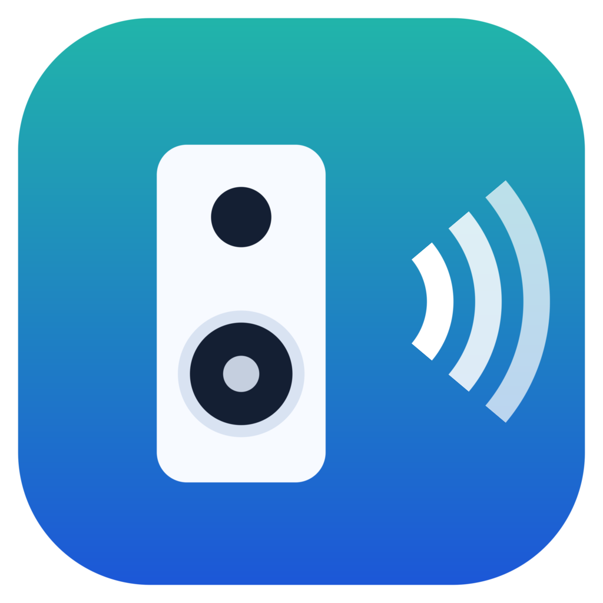

# MusicCast Controller

A lightweight native desktop controller for MusicCast-compatible network speakers
and receivers, written in Rust with [egui/eframe](https://github.com/emilk/egui).



## Features

- **Automatic discovery** of speakers on your local network via SSDP/UPnP,
  plus adding a device manually by IP address
- **Basic control**: power on/off, mute, volume (with dB readout), input selection and zones
- **Instant updates**: speakers push change notifications over UDP; polling is only a fallback
- **Playback**: play/pause, previous/next, repeat and shuffle, with now-playing
  info and album art
- **Tuner**: band selection (FM/AM/DAB, depending on the device), frequency tuning, RDS/DAB station
  info and one-click presets (right-click a preset to store the current station)
- **Sound**: sound programs, tone and equalizer controls, Direct, Enhancer,
  Bass Extension and Clear Voice (when the device supports them)
- **Multiroom (MusicCast Link)**: let other speakers play along with the selected one, with
  per-speaker and group volume; leave or end a group
- **Browse** network/USB sources and recall stored presets
- **Stream local music files** (mp3, flac, aac, wav, m4a, …) to a speaker through
  a built-in HTTP file server and UPnP AVTransport; pick several files or drop files/folders
  on the window, and the queue advances automatically
- **Keyboard**: Space play/pause, ↑/↓ volume, M mute; scroll over the volume slider
- Configurable status polling interval, display dimmer, English and Dutch UI,
  and system/light/dark appearance

## How it works

The app talks to devices over their local HTTP API (`http://<device-ip>/YamahaExtendedControl/v1/...`)
and uses UPnP for discovery and file streaming. Everything stays on your local
network; there is no cloud service involved.

| Module          | Responsibility                                          |
|-----------------|---------------------------------------------------------|
| `main.rs`       | Entry point, wires the worker to the UI                 |
| `ui.rs`         | egui user interface                                     |
| `worker.rs`     | Background thread: discovery, polling, commands         |
| `api.rs`        | HTTP API calls and JSON parsing                         |
| `discovery.rs`  | SSDP M-SEARCH discovery                                 |
| `stream.rs`     | Local file server and UPnP AVTransport push             |
| `model.rs`      | Device and state data types                             |
| `icon.rs`       | Procedurally drawn app icon                             |

## Building

Requires a recent stable Rust toolchain ([rustup.rs](https://rustup.rs)).

```sh
cargo build --release
./target/release/network-speaker-control
```

Extra command-line options:

- `--screenshot <file.png>`: render the UI offscreen, save a screenshot, then exit
- `--make-icon <file.png>`: write the 1024 px app icon and exit
- `--demo`: show made-up speakers without touching the network (handy with `--screenshot`)

Run the unit tests with `cargo test`.

### macOS disk image

```sh
./make_mac_dmg.sh            # → dist/Controller-for-MusicCast-<version>.dmg
./make_mac_dmg.sh --clean    # same, then `cargo clean`
```

The script builds a release binary, wraps it in an ad-hoc signed `.app` with
the icon from `assets/app-icon.png`, and packs it with an Applications shortcut.
The version comes from `Cargo.toml`. Because the app has no Developer ID
signature, the first launch on another Mac needs right-click → Open.

The app is developed and tested on macOS. Because it is built on eframe,
it should also build on Linux and Windows, but that hasn't been tested.

## Disclaimer

This is an independent, unofficial project. It is not affiliated with, endorsed
by or sponsored by Yamaha Corporation. "Yamaha" and "MusicCast" are trademarks of
their respective owners and are used here only to describe compatibility.

## License

Copyright (C) 2026 Frank Gerritse

This program is free software: you can redistribute it and/or modify it under
the terms of the GNU General Public License as published by the Free Software
Foundation, either version 3 of the License, or (at your option) any later
version. See [LICENSE](LICENSE) for the full text.
